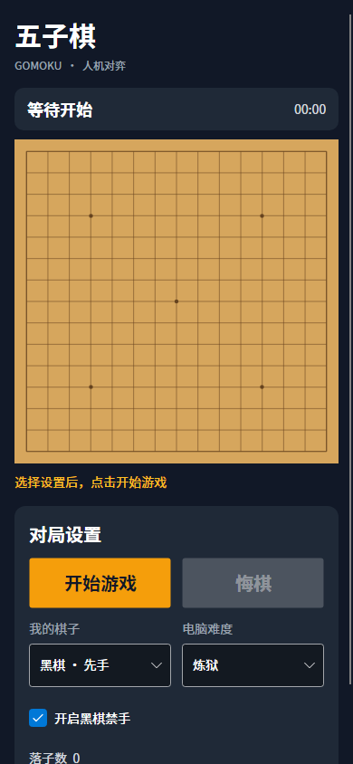

# WUZIQI · 五子棋

采用 .NET 11 和 Avalonia 11.3.12，共用一套棋局逻辑与界面，支持 Windows 桌面和 Android 手机。

## 下载

在 [Releases](https://github.com/Nadoric/WUZHIQI.Avalonia/releases) 下载正式版本：

- **Windows x64**：解压 `WUZIQI-Windows-x64-Release.zip` 后运行 `WUZIQI.Desktop.exe`，需要 .NET 11 x64 运行时或 SDK。
- **Android ARM64**：安装 `WUZIQI-android-arm64-release.apk`，支持 Android 7.0（API 24）及以上的 64 位 ARM 设备。
- `SHA256SUMS.txt` 提供安装包校验值。

新版 Android 包名为 `com.wuziqi.gomoku`。与旧包名的版本作为不同应用安装。

## 功能

- 15×15 棋盘，支持执黑先手、执白后手、计时、悔棋和胜负标记。
- 七档电脑难度，默认炼狱。采用迭代加深、Alpha-Beta 剪枝、局面缓存和增量估值，炼狱思考预算约 900 毫秒。
- 前中期积极争胜，识别双成五点及带空位的进攻棋形；达到 180 子后放宽防守，203 子后进一步保留玩家取胜机会。棋形已无法成五时仍可能和棋。
- **黑棋禁手默认开启**，可通过复选框关闭。棋色、难度和禁手开关均在重新开始后生效。
- 手机竖屏上下布局，宽屏左右布局；棋盘等比缩放、支持触控和纵向滚动。拖动滚动不会落子。
- 内置中文常规和粗体字体；操作按钮文字放大并居中；电脑端包含多尺寸程序图标及窗口图标。
- 电脑在后台搜索，悔棋、重开或离开界面时取消旧计算。当前版本不含存档，系统终止进程后不恢复对局。



## 黑棋禁手

开启时，黑棋禁止三三、四四和长连，白棋无禁手：

- 玩家执黑点击禁手点时，不落子、不切换回合，并提示具体原因。
- 电脑执黑的候选落点、搜索分支、战术分析和后期让步都会排除禁手。
- 长连始终禁止；恰好五连优先于三三、四四。
- 活四的两个成五点只计一个四，同方向的不同四可以构成四四。
- 活三必须能通过合法落子形成两端均可合法成五的活四，递归排除边缘、封堵、长连或禁手延伸导致的假活三。
- 黑棋没有合法落点时白棋获胜。

关闭禁手后，黑白双方都按连续五子及以上获胜。三、四的形状及假活三定义参考 [RIF 规则](https://www.renju.net/rifrules/)；本应用采用阻止禁手落子的交互及长连始终禁落的约定，不包含比赛开局交换与停着规则。

## 开发环境

- .NET 11 SDK；项目使用 `global.json` 选择 11.0 系列 SDK。
- Android 开发另需 `android` 工作负载、JDK 21、Android SDK API 37、Build Tools 37.0.0 和 platform-tools。

```powershell
dotnet workload install android
dotnet run --project .\src\WUZIQI.Desktop
```

也可打开 `WUZIQI.slnx`，选择 `WUZIQI.Desktop` 或 `WUZIQI.Android` 为启动项目。只运行桌面版不需要 Android 环境。

## 打包

Windows x64（依赖 .NET 11 运行时）：

```powershell
dotnet publish .\src\WUZIQI.Desktop -c Release -r win-x64 --self-contained false -o .\artifacts\desktop\win-x64
```

Android 调试包：设置 `ANDROID_HOME`、`JAVA_HOME` 后运行 `build-apk.cmd`，也可指定路径：

```powershell
.\build-apk.cmd -AndroidSdkDirectory "D:\Android\Sdk" -JavaSdkDirectory "D:\Java\jdk-21"
```

脚本也支持读取未纳入版本控制的 `android-build.local.json`。默认输出为 `artifacts/apk/Debug/android-arm64/*-Signed.apk`，模拟器可传 `-Runtime android-x64`。

Android 正式签名：

```powershell
keytool -genkeypair -keystore wuziqi.keystore -alias wuziqi -keyalg RSA -keysize 3072 -validity 10000
```

在当前终端设置 `WUZIQI_KEY_PASSWORD` 和 `WUZIQI_STORE_PASSWORD`，再运行：

```powershell
.\build-apk.cmd -Configuration Release -KeyStore .\wuziqi.keystore -KeyAlias wuziqi
```

正式包输出到 `artifacts/apk/Release/android-arm64`。密码通过环境变量传给构建工具；签名密钥、本机配置、SDK 和构建缓存不纳入版本控制。后续正式版需使用同一签名密钥；调试包和正式包签名不同，切换时需要卸载原包。

## 检查

```powershell
dotnet run --project .\tests\WUZIQI.Checks -c Release
dotnet run --project .\tests\WUZIQI.LayoutChecks -c Release -- .\artifacts\previews
powershell -NoProfile -ExecutionPolicy Bypass -File .\verify-apk.ps1 -ApkPath .\artifacts\apk\Release\android-arm64\com.wuziqi.gomoku-Signed.apk
```

规则检查覆盖攻防、悔棋、取消、分阶段策略、三类禁手、八种对称棋形、假活三、白棋豁免、无合法落点、七档电脑合法落子和禁手关闭行为。界面检查覆盖四种屏幕尺寸、中文字体、后台电脑应战、禁手提示及开关。

## 目录

```text
src/WUZIQI/                 共享界面、棋局、禁手规则和电脑搜索
src/WUZIQI.Desktop/         桌面入口
src/WUZIQI.Android/         Android 入口、Manifest、主题和图标
tests/WUZIQI.Checks/        棋局、搜索与禁手检查
tests/WUZIQI.LayoutChecks/  字体、布局及界面交互检查
build-apk.ps1               APK 构建和签名
verify-apk.ps1              APK 签名、对齐与 Manifest 检查
```

内置字体采用 SIL Open Font License 1.1，完整许可见 [字体许可证](src/WUZIQI/Assets/Fonts/LICENSE.txt)。
